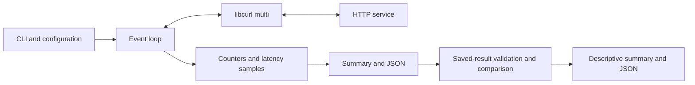

# Architecture

Systems Performance Engine consists of a native HTTP workload runner, a native saved-result comparison module, and separate experiment tools. The runner executes one bounded workload and exports its measurements. Comparison validates and summarizes saved native results without sending traffic. Python helpers manage Petclinic experiments; they are not part of the engine runtime.

## Native components

| Component | Source | Responsibility |
| --- | --- | --- |
| CLI | [main.cpp](../src/main.cpp) | Arguments, process signals, output-file reservation, result writing, and exit status. |
| Configuration | [config.cpp](../src/config.cpp), [config.hpp](../include/spe/config.hpp) | Workload limits, CLI validation, and HTTP URL parsing. |
| Execution | [engine.cpp](../src/engine.cpp), [engine.hpp](../include/spe/engine.hpp) | Request dispatch, libcurl handle ownership, transfer completion, deadlines, and cancellation. |
| Endpoint assignment | [workload.cpp](../src/workload.cpp) | Maps arrival ordinals and expired ranges to weighted paths independently of admission and completion. |
| Arrival schedule | [schedule.cpp](../src/schedule.cpp) | Computes monotonic deadlines and advances past expired arrivals in constant time and space. |
| Measurement | [result.cpp](../src/result.cpp), [result.hpp](../include/spe/result.hpp) | Outcome counters, latency aggregation, JSON serialization, and human-readable summaries. |
| TLS configuration | [tls.cpp](../src/tls.cpp), [tls.hpp](../include/spe/tls.hpp) | Bounded CA-bundle loading, SHA-256 identity, and recognized libcurl TLS error categories. |
| Request headers | [headers.cpp](../src/headers.cpp), [headers.hpp](../include/spe/headers.hpp) | Private JSON input, field validation, and immutable libcurl header-list ownership. |
| Comparison | [compare.cpp](../src/compare.cpp), [compare.hpp](../include/spe/compare.hpp) | Bounded JSON input, result validation, compatibility checks, descriptive calculations, and reports. |

libcurl supplies HTTP parsing, TLS, URL handling, connection pooling, and the asynchronous multi interface. It is an external dependency. SHA-256 uses system cryptography APIs: CommonCrypto on macOS, OpenSSL Crypto on Linux. The comparison module uses the vendored nlohmann/json 3.12.0 parser; its upstream revision, hashes, and MIT notice are preserved in `third_party/nlohmann/`. The current runner uses one event loop rather than a request-thread pool.

## Execution and ownership

`spe::run` executes on the calling thread. All HTTP handle access and measurement updates occur there. libcurl's asynchronous DNS backend may use resolver helper threads.

A run allocates a fixed pool of reusable easy handles, limited to the smaller of request count and configured concurrency. The default closed-loop model refills slots on completion. Fixed-rate mode keeps free handles in a preallocated list. It polls until socket activity, the next arrival or window end, with a 50 ms cancellation check. A single cursor advances past expired deadlines. The scheduler admits at most the newest due arrival and drains active handles after the window closes.

RAII owners release easy and multi handles on normal return or exceptions. Active handles are removed before the multi handle is destroyed. Response bodies are streamed through a discard callback with a per-request byte limit. Connection limits and sample storage are bounded by configuration; the sample arrays hold up to roughly 16 MB of request durations plus 8 MB of dispatch delays in fixed-rate mode at the request-count cap, excluding transport and container overhead. Mixed runs reserve up to 16 MB more for exact per-endpoint latency samples.

Signal handlers set a `sig_atomic_t` flag. The event loop observes cancellation at dispatch/completion boundaries and after poll waits capped at 50 ms. Shutdown collects known completions, cancels active work, and reports the remaining undispatched budget. Server-side processing can continue after client cancellation.

## Transport behavior

A workload sends HTTP/1.1 requests over HTTP or HTTPS. Fixed-rate GET runs can use two weighted paths on one origin. The timer returns the first ordinal and the number expired. Endpoint assignment uses integer prefix counts to apportion even a long expired range in constant space and time. Each detached handle changes its URL when the next ordinal chooses a different path. The slot retains that endpoint through completion or cancellation. GET and HEAD reuse connections. Every write sets libcurl’s fresh-connection and forbid-reuse options to avoid replay after a stale connection. Redirects, environment proxies, cookies, and application-level retries are disabled.

HTTPS explicitly enables peer-chain and hostname verification and requires TLS 1.2 or later. Each handle is restricted to the target's scheme; HTTPS has no plaintext fallback. Default roots come from libcurl's configured trust store. A custom CA file is read once into a bounded immutable buffer, hashed, and supplied through `CURLOPT_CAINFO_BLOB`. The buffer outlives every easy handle. Unsupported custom-CA backends fail before dispatch. Private CA paths and certificate contents are omitted from results.

Requests specify identity encoding. The engine reads the entire framed response within the total timeout and body-size limit, then discards the bytes. It does not assert application content. A complete 2xx response is successful; an incomplete 2xx body is a transport failure.

Custom request headers are loaded before dispatch from a bounded owner-only JSON file. One RAII-owned `curl_slist` outlives all easy handles and is shared without mutation; no header configuration is allocated per logical dispatch. All values stay private to execution. Duplicates, control characters, and routing/framing/connection overrides are rejected. Empty values use libcurl's explicit empty-field syntax. See the [header reference](USAGE.md#configurable-request-headers) for limits and policy.

POST, PUT and PATCH share a single immutable payload across all handles. An explicit byte length preserves embedded NULs. The engine supplies Content-Length through libcurl and suppresses automatic Expect negotiation. The payload outlives every easy handle. DELETE has no request body. Request budgets and fixed arrival windows apply to all methods.

## Measurement contract

| Measurement | Definition |
| --- | --- |
| Request duration | `steady_clock` time immediately before handle registration through terminal completion observation. Includes DNS, TCP/TLS establishment, certificate verification, and local event-loop overhead. |
| Run elapsed time | Closed-loop dispatch through final completion/cancellation, or the fixed arrival window plus drain. Preparation and percentile sorting occur outside the measured interval. |
| Successful throughput | Complete 2xx responses divided by run elapsed time. |
| Completed throughput | All terminal successes/failures divided by the same elapsed time; excludes cancellations. |
| Successful latency | Complete 2xx samples only. |
| Completed latency | Success, HTTP error, connection/network/TLS error, timeout, and response-limit samples. |
| Percentiles | Exact nearest rank, computed after the measured interval. Empty distributions serialize as `null`. |

Accounting preserves `requested = started + not_started` and `started = completed + cancelled`. Cancelled and undispatched requests have no request-duration samples. Fixed-rate dispatch delay is sampled at handle registration for every started request, including later cancellations.

Closed-loop operation does not maintain a fixed arrival rate during slowdown and does not correct coordinated omission. The engine reports client-observed duration, not isolated server processing time. Full field definitions and exit codes are in the [CLI reference](USAGE.md#measurement-and-exit-semantics).

## Result storage

`RunResult` contains workload settings, terminal outcomes, HTTP status and transport-error counts, elapsed time, latency summaries, interruption state, and build/library provenance. SPE 0.6.0 exports result schema 6. The workload records method, payload byte count and connection reuse policy. Mixed results include ordered paths, reduced weights, delivery and miss counts, rates and latency by path. The workload identifies its model and arrival schedule. Fixed-rate results add scheduling counters, rates and dispatch delays. Closed-loop results use null scheduling fields. Both retain TLS policy/outcomes and `headers` metadata with sorted names and `values: redacted`. Header values, their hashes, and the header-file path are omitted. Custom CA bundles are identified by SHA-256; default trust-store contents are not fingerprinted. Individual native request samples are used internally and are not exported.

File output is reserved with exclusive creation before traffic starts. Existing destinations are rejected; an interrupted or failed write can leave a partial new artifact.

## Saved-result comparison

`spe compare` reads regular local files with bounded size and nesting, rejects duplicate JSON keys, and validates the supported native schema and measurement contract. It checks counter equations, outcome maps, sample counts, latency bounds, throughput denominators, workload settings, and recorded engine identity before computing differences. Hosts or ports may differ only with explicit acknowledgment; endpoint paths and queries must match.

Groups aggregate successful throughput from total successes and seconds, mean latency from successful sample counts, and percentile summaries from medians of per-run percentiles. Per-run ranges and sample standard deviations describe variation, not statistical certainty. Failed or incomplete groups retain diagnostic totals but suppress performance deltas. Comparison output has its own schema version 6 and `kind: spe_comparison`.

Schema 5 GET results with endpoint mix metadata, schema 4 single-target fixed-rate and closed-loop results and schema 3 closed-loop results remain supported. Schema-1/SPE-0.1.0 and schema-2/SPE-0.2.0 results remain supported with implied empty custom-header metadata. Schema 1 also implies zero TLS errors and no TLS policy. Original field sets are checked before normalization. Input schema contracts cannot be mixed. HTTPS comparisons require matching verification policy and custom-bundle fingerprints. Custom-header comparisons require matching name lists plus `--allow-redacted-headers`, acknowledging unverifiable values and authorization context. Origin acknowledgement cannot override a transport, header-name or trust-policy mismatch.

The comparison module has no HTTP execution or application lifecycle responsibilities. It cannot verify application revisions, independent JVM blocks, overlapping runs, or environmental equivalence from native result files. Independence remains an experimental assumption; the command performs no significance test or automatic verdict. The [CLI reference](USAGE.md#compare-saved-results) defines limits and exit behavior.

## Experiment tools

| Tool | Role |
| --- | --- |
| `compare_petclinic.py` | Preserved-JAR selection, fresh JVM lifecycle, A–B–B–A ordering, warm-up/conditioning, response checks, artifact hashes, and descriptive reports. |
| `prepare_petclinic.py` | Pinned public-source checkout, verified patches, sequential application builds/tests, reference-page capture, and artifact provenance. |
| `reference_k6.py` / `reference_k6.js` | Independent closed-loop reference, original k6 summaries, and normalized results with explicit measurement definitions. |
| `experiment_diagnostics.py` | Separate JFR, GC/JIT, resource, and stack-sampling experiments. Host collection currently targets macOS. |
| `validate_measurements.py` | Bounded smoke, timing, control, and diagnostic suites. |
| `summarize_validation.py` | Offline block-level summaries and unchanged-code variability. |
| `inspect_petclinic_sql.py` | Actual-request SQL logging for the original owner-reuse change. |

The Petclinic workflow consumes preserved local build artifacts. The builder creates them in an isolated checkout from the pinned specification and patches in `benchmarks/petclinic/`; existing sibling checkouts remain supported. Its optional validation profile executes bounded delay/CPU work and exposes counters that confirm the configured paths ran. Preparation tests also cover checksum validation, test-report acceptance, and cleanup of forked build processes on timeout.

Experiment archives retain commands, aggregate JSON, stdout/stderr, hashes, source patches, and manifests. Original k6 summaries remain alongside normalized output. k6 latency boundaries and percentile methods differ from SPE's; normalized field names do not make the measurements interchangeable.

Fresh JVM blocks are the comparison units. The helpers compute descriptive differences without statistical verdicts. Diagnostic runs are excluded from unprofiled timing comparisons. Methodology, results, and remaining limits are documented in [measurement validation](VALIDATION.md).

## Verification and platform coverage

Native unit tests cover configuration, accounting, aggregation, serialization, and cancellation logic. HTTP integration tests run a loopback service to exercise reuse, concurrency, slow responses, HTTP/transport errors, timeouts, body limits, and process signals. Separate k6 and Petclinic experiments provide reference-tool and application-level evidence.

Comparison tests exercise saved application evidence, arithmetic, multiple-run summaries, malformed and incompatible inputs, partial results, and safe file output. Producer/consumer checks run real HTTP workloads and compare their saved results.

TLS tests generate a private local CA without installing it in the operating system. Real connections exercise valid and invalid certificate chains, expiry, hostname mismatch, handshake rejection, reuse, concurrency, secure-body failures, timeouts, and signals. Public certificate evidence and raw results remain local; fixture signing keys are deleted after each suite.

The implemented build targets POSIX systems. Release and ASan/UBSan functional suites have passed on macOS arm64 and Ubuntu 24.04 arm64 in Docker. The [CI workflow](../.github/workflows/ci.yml) defines Release and sanitizer jobs for Ubuntu 24.04 x86_64. Windows is unsupported. Shared-runner timing output is functional test evidence, not a benchmark. Statistical methods, additional load models, and broader platform coverage are tracked in the [roadmap](ROADMAP.md).
